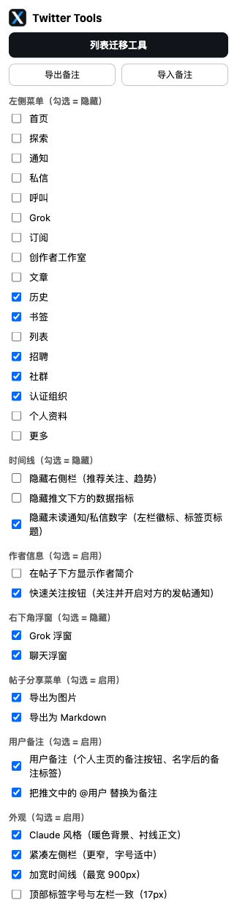
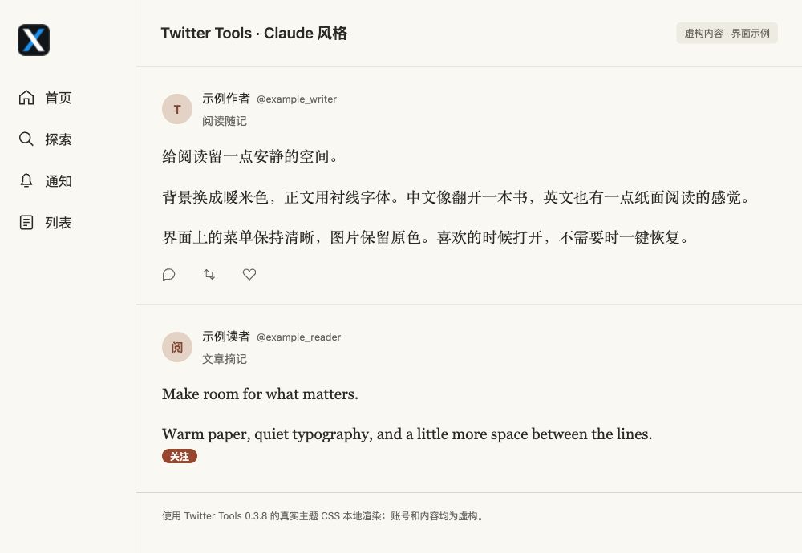
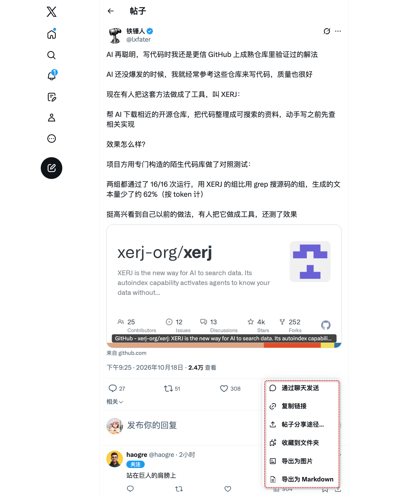
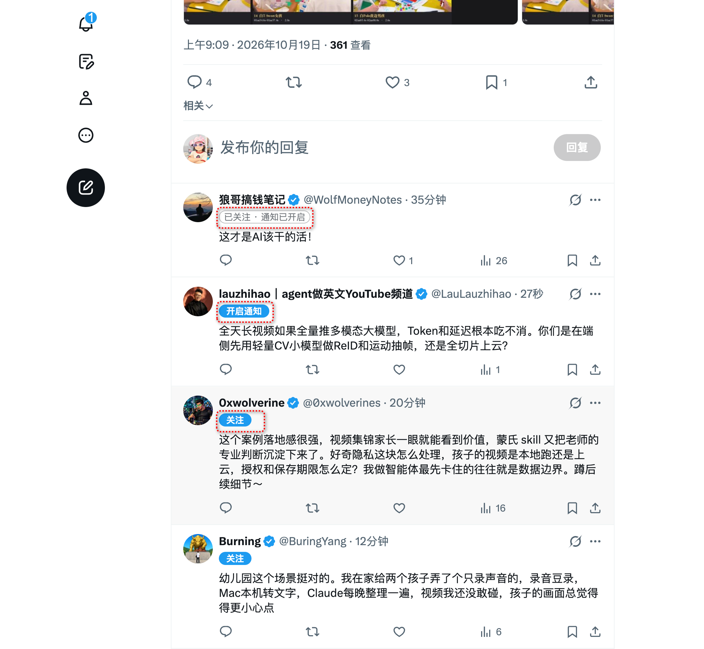
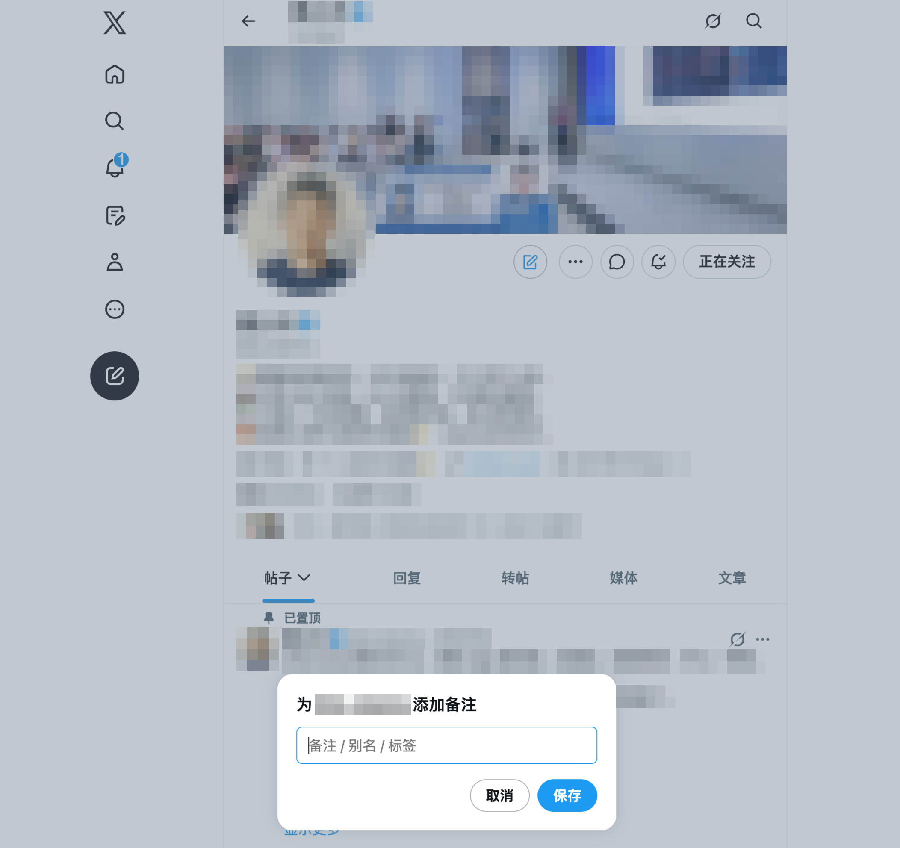
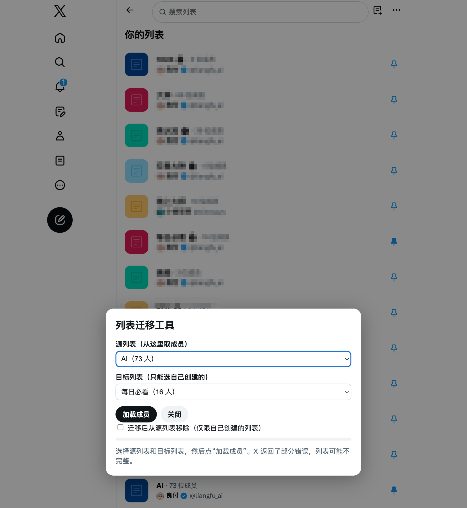

# Twitter Tools


优化 Twitter/X 阅读体验的 Chrome 扩展（Manifest V3），使用原生 JavaScript，无构建步骤。

当前版本：**0.3.8**。

## 亮点

- **零依赖、零构建**：原生 JavaScript，克隆后直接「加载已解压的扩展程序」即可使用；测试也只用 Node 内置的 `node:test`。
- **开关即时生效**：在弹窗里调整设置，当前页面随即更新，无需刷新。
- **最小权限、无服务端**：只申请 `storage` 和 x.com / twitter.com 的访问权限；设置可随 Chrome 同步，备注和作者缓存保存在本地，图片、Markdown 和备注备份导出为本地文件。
- **写操作稳妥**：关注前重新读取关系并核对账号 ID 与当前登录者，确认关注成功后才开启发帖通知；通知失败可单独重试，不会重复关注；私密账号待批准前不开通知。列表迁移先加入目标再移除源，加入失败绝不移除，可随时停止并取消等待中的请求。
- **克制地调用接口**：只为视口附近的作者逐个请求，缓存 12 小时；遇到限流按重置时间暂停，滚出视口的请求直接丢弃。
- **适应 X 改版**：运行时从 X 自己的脚本中读取 GraphQL 查询 ID 和功能参数；X 重新渲染后自动恢复注入的菜单项和按钮。
- **保留失败反馈**：成员读取和迁移写入遇到接口错误时按失败处理；列表概览只兼容已知解码错误，并提示结果可能不完整。
- **有测试兜底**：53 项测试覆盖设置、脚本加载顺序、接口错误与限流、列表迁移顺序与取消、关注与通知的各种中间状态，全部使用模拟接口，不触碰真实账号。

## 功能清单

| 分区 | 功能 | 设置含义 |
| --- | --- | --- |
| 左侧菜单 | 首页、探索、通知、私信、呼叫、Grok、订阅、创作者工作室、文章、历史、个人资料、更多，可分别隐藏 | 勾选表示隐藏 |
| 左侧快捷入口 | 书签、列表、招聘、社群、认证组织；支持有文字和仅图标两种菜单布局 | 取消勾选时补充入口，勾选时隐藏 |
| 时间线 | 隐藏右侧推荐与趋势、隐藏帖子互动数据、隐藏导航栏未读徽标及标签页标题中的未读数字 | 勾选表示隐藏 |
| 作者信息 | 在帖子下方显示作者简介，点击展开或收起；显示快速关注按钮，关注成功后开启对方发帖通知 | 勾选表示启用 |
| 右下角浮窗 | 分别隐藏 Grok 浮窗、聊天浮窗 | 勾选表示隐藏 |
| 帖子分享菜单 | 导出 PNG 图片、导出 Markdown，入口位于帖子分享菜单中 | 勾选表示启用 |
| 用户备注 | 在个人主页添加或编辑备注、点击名字后的备注标签编辑、用备注替换帖子中的 @提及；支持 JSON 导出和合并导入 | 勾选表示启用，导入与导出使用弹窗按钮 |
| 外观 | Claude 风格的暖色背景与衬线正文、紧凑左侧栏、加宽时间线至最多 900px、将顶部标签字号调整为 17px | 勾选表示启用 |
| 列表迁移 | 读取列表和成员，复制或移动到本人创建的列表；支持全选、仅选已关注、清空选择、进度显示与停止操作 | 从弹窗打开工具，默认复制；勾选移除源成员才执行移动 |

快速关注会区分「关注」「已关注 · 通知已开启」「开启通知」「已申请 · 待批准」等状态。通知失败可重试；私密账号需要对方批准后，点击按钮重新检查审批状态，再开启通知。

在「外观」中启用「Claude 风格」后，页面使用暖米色背景和深灰文字，帖子正文采用衬线字体，菜单与按钮保留界面字体。关闭开关即可恢复 X 原有样式。字体使用本机已安装的 Anthropic Serif、Georgia、思源宋体或宋体等字体，不下载额外字体；不同系统上的效果会略有差异。

## 截图

### 设置弹窗

按分区调整开关，顶部可打开列表迁移工具、导出或导入备注。下图使用 0.3.8 的设置页面代码在本地渲染，示例中已启用「Claude 风格」。



### Claude 风格

暖米色背景、深灰文字和衬线正文，菜单保持界面字体。下图使用扩展的真实主题 CSS 和虚构账号内容在本地渲染，展示中英文阅读效果，不包含真实账号信息；实际字体随本机已安装字体而变化。



### 阅读界面与左侧菜单

隐藏不常用的入口和右侧栏，搭配紧凑导航与加宽时间线。截图展示的是一组自定义设置，功能可独立开关。


### 帖子导出

打开帖子分享菜单，选择「导出为图片」或「导出为 Markdown」，文件下载到本地。



### 快速关注与发帖通知

在帖子中直接关注作者并开启其发帖通知；截图同时展示了关注入口、通知重试入口和完成状态。



### 用户备注

在个人主页打开备注编辑框，填写别名或标签。保存后可在名字后显示备注，并按设置替换帖子中的 @提及；截图中的编辑框尚未填写备注。



### 列表迁移

选择源列表和本人创建的目标列表，再加载成员。可复制成员，也可勾选从源列表移除；截图中的部分列表信息已打码。



## 安装与更新

1. 下载仓库或克隆到本地。
2. 在 Chrome 打开 `chrome://extensions`，开启「开发者模式」。
3. 点击「加载已解压的扩展程序」，选择包含 `manifest.json` 的目录。
4. 打开或刷新 `https://x.com`，点击浏览器工具栏中的 Twitter Tools 调整设置。

更新文件后，在扩展管理页点击重新加载，再刷新 X 页面。设置会立即应用；「左侧菜单」「时间线」「右下角浮窗」勾选表示隐藏，其他分区按标题提示使用。

## 数据与操作

- 扩展只声明 `storage` 权限及 `x.com`、`twitter.com` 网站访问权限。
- 开关使用 Chrome 同步存储；备注和作者信息缓存使用本地扩展存储。Chrome 开启同步时，开关可能随浏览器账号同步。
- 作者简介或快速关注启用时，会使用当前 X 登录会话读取视口附近作者的信息，缓存约 12 小时，最多 800 个作者；默认快速关注开启、简介关闭。
- 点击「关注」会向 X 提交真实关注请求，确认关注成功后开启对方的发帖通知；全部成功后显示「已关注 · 通知已开启」。通知未确认开启时显示「开启通知」，点击可重试，刷新页面后仍保留重试入口。
- 列表迁移也会修改真实列表，开始前会显示源、目标相关操作的确认提示。
- 点击后会重新核对账号与关注关系再提交；通知重试只更新通知设置，不会重复提交关注。
- 私密账号需要批准时显示「已申请 · 待批准」，点击可重新检查审批状态，获批后再开启通知。此功能不会自动接受别人向你提交的关注请求，也不会申请浏览器或系统通知权限。通知送达仍取决于 [X 客户端和系统的通知设置](https://help.x.com/en/managing-your-account/notifications-on-mobile-devices)。
- 扩展没有自建服务端。帖子与备注导出为本地文件；请自行保管备注备份。

## 列表迁移

从插件弹窗打开「列表迁移工具」，选择源列表和自己创建的目标列表，加载成员后选择需要处理的账号。默认复制；勾选「迁移后从源列表移除」才会移动成员，且只允许从自己的列表移除。

移动时先加入目标列表，再从源列表移除。加入失败不会执行移除。停止或关闭窗口会中断等待和后续请求；已经到达 X 的请求可能已生效，请重新加载列表核对结果。每轮操作后必须重新加载成员才能再次执行。

## 开发与验证

安装 Node.js 22 或更新版本后运行：

```sh
npm test
```

无需安装 npm 依赖。测试使用 Node 内置测试框架和模拟 DOM/接口，不访问真实账号。测试涵盖设置与备注、脚本加载、接口桥接、错误与限流处理、列表迁移顺序与取消、作者信息队列，以及关注与通知的请求顺序、私密账号审批、通知重试和登录账号切换。

## 已知限制

- X 的 DOM 与内部接口会变化，相关功能可能需要随改版更新。
- 列表选择当前读取前 100 个列表；成员读取最多 200 页，超出时中止，不提供不完整结果供迁移。
- 列表概览遇到 X 已知的解码错误时，会保留可用列表并提示结果可能不完整。成员读取和迁移写入仍严格检查接口错误。
- 作者关注状态使用缓存，通过 X 原生界面或其他标签页更改后，按钮状态可能暂时滞后。
- 图片导出采用回退字体，换行可能与网页不同。Markdown 不展开「显示更多」后的长文，视频保存为原帖链接。
- 自动测试不能替代重载真实扩展后的浏览器验证；关注、迁移等写操作需要使用获授权的测试账号与列表验证。

## 第三方代码

`lib/html-to-image.js` 来自 html-to-image 1.11.13。已附带 [MIT 许可证](lib/html-to-image.LICENSE)，对应[上游许可证](https://github.com/bubkoo/html-to-image/blob/v1.11.13/LICENSE)。项目自身代码尚未指定许可证。
